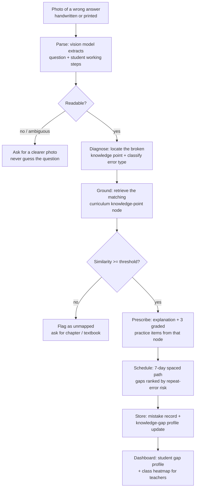

# Pathfinder AI · Every Wrong Answer Is a Map

> Turning a single photo of a wrong answer into a **personalized, syllabus-aligned review path** — and saying "I can't read this" rather than inventing a diagnosis.

Next Horizon 2026 · Team **KK_garden** · Theme: Artificial Intelligence (AI) · Build window Nov 28–30, 2026

**Pathfinder AI** is for students who study hard and still repeat the same mistakes, and for the teachers who cannot diagnose forty students one by one. A student photographs a problem they got wrong; a multimodal model reads both the question and their own working steps, locates the exact knowledge point where the reasoning broke, and returns a short explanation, graded practice items, and a 7-day review path. Every upload accumulates into a knowledge-gap profile, so review stops being generic and starts being personal.

## How it works



**The diagnosis is structured, not prose.** One photo in, one JSON object out — a wrong answer is only useful if it becomes data. This is real output from `python diagnose.py --sample samples/alg_distributive.json --trace`:

```json
{
  "status": "ok",
  "question": "Find the value of x: 2(x+3) = 4x - 6",
  "steps": ["2x + 3 = 4x - 6", "3 = 2x - 6", "x = 4.5"],
  "broken_step": "2x + 3 = 4x - 6",
  "error_type": "conceptual",
  "knowledge_point": "ALG-7.3",
  "confidence": 0.9,
  "practice": ["ALG-7.3 #1 (easy)", "ALG-7.3 #2 (medium)", "ALG-7.3 #3 (applied)"],
  "schedule": [{"day": 1, "item_id": "ALG-7.3 #1"}, {"day": 3, "item_id": "ALG-7.3 #2"}, {"day": 7, "item_id": "ALG-7.3 #3"}],
  "flags": {"unmapped": false, "needs_teacher_review": false, "provider": "offline-rule-baseline", "grounding_score": 0.8621, "threshold": 0.42}
}
```

### Design decisions, mapped to what good diagnosis looks like

| Decision | Why |
|---|---|
| Error type is a closed taxonomy — `conceptual` / `procedural` / `careless` / `unreadable` | Different errors need different remedies; "study harder" is not a diagnosis |
| The model must cite **the broken step**, not just the wrong answer | A final wrong answer can hide three different failures; the step is where teaching happens |
| Practice items are **retrieved from the curriculum graph**, never generated freehand | Generated items drift off-syllabus and are silently ungraded — grounding keeps them teachable |
| Below the similarity threshold the knowledge point is reported **unmapped**, not guessed | A wrong knowledge point sends the student to study the wrong chapter; a gap is cheaper than a false lead |
| Unreadable or ambiguous photos **route to a retake request** | A confident diagnosis of a misread question is worse than no diagnosis |
| Confidence is surfaced to the student and teacher, never hidden | Teachers must know when to trust the machine and when to look themselves |
| Scheduling follows spaced retrieval (day 1 / 3 / 7) with a **cap of 3 items per day** | A 7-day path that demands 2 hours a night is abandoned by day 2 |
| Mistake records are append-only; the gap profile is recomputed, never overwritten | Longitudinal repeat-error rate is the metric we are judged on |

### The scheduling rule

Rank each open knowledge point by `risk = repeat_count × recency_weight × error_severity(conceptual 3 / procedural 2 / careless 1)`, halved for each cleared practice item, take the top gaps, and spread them across days 1 / 3 / 7. Conceptual errors outrank careless ones at equal risk — being careless about the wrong idea is still the wrong idea.

## Quick start

```bash
pip install -r requirements.txt
cp .env.example .env          # Windows: copy .env.example .env

python diagnose.py --sample samples/alg_distributive.json --trace   # no key needed
python diagnose.py --question "Solve x - 4 = 10" --steps "x = 10 - 4;x = 6"
python diagnose.py --image photo.jpg --trace                         # needs a vision provider
python eval.py --set samples --save                                  # accuracy report → traces/
python -m unittest discover -s tests                                 # offline, no API spend
streamlit run app.py                                                 # student + teacher UI
```

With `LLM_API_KEY` / `LLM_BASE_URL` set, the pipeline calls a real OpenAI-compatible endpoint (chat + vision + embeddings). Without them it runs `PATHFINDER_OFFLINE` mode on the rule baseline and **labels every output `provider: offline-rule-baseline`**, so a baseline result can never be mistaken for a model diagnosis. The inference layer is pluggable (`llm.py`): switching providers is a `.env` change, no code edits. Keys live only in `.env`, which is git-ignored.

## Verified runs — real traces in [`traces/`](traces/)

Every row below is a saved trace produced by an unmodified checkout. Read the caveat after the table.

| Trace | Input | Error type | Knowledge point | Grounding score | Outcome |
|---|---|---|---|---|---|
| [`20261031_145853_alg_distributive`](traces/20261031_145853_alg_distributive.md) | `2(x+3)=4x-6` → `2x+3=4x-6` → `x=4.5` | conceptual | ALG-7.3 | 0.8621 | Broken step located; 3 items scheduled day 1/3/7 |
| [`20261031_145853_phy_unit_conversion`](traces/20261031_145853_phy_unit_conversion.md) | 500 g mass, 10 N, `a = F/m = 10/500` | procedural | PHY-9.2 | 0.5856 | Unit conversion flagged; path built |
| [`20261031_145854_unreadable_photo`](traces/20261031_145854_unreadable_photo.md) | empty / unreadable input | unreadable | — | — | **No diagnosis emitted** — routed to a retake request |
| [`eval_20261031_145842`](traces/eval_20261031_145842.md) | all 7 samples | 7/7 type agreement | 7/7 knowledge point | — | 6/7 broken steps located; 1 flagged for review |
| `python -m unittest discover -s tests` | 23 offline tests | — | — | — | All pass, zero API spend |

> **Read this before quoting the numbers.** These runs use the **offline rule baseline** (`offline-rule-baseline`), whose misconception rules were written against `samples/`. The 100% agreement above verifies that the *pipeline wiring* — parsing, diagnosis routing, grounding thresholds, scheduling, persistence — behaves as specified. It is **not** a measure of model accuracy, and we are not claiming it is. Teacher-labelled agreement against a real multimodal model is still pending API access (see Evaluation plan); when it runs, its numbers replace this table.

**What each run demonstrates**

1. **The broken step is the product, not the verdict.** In the distributive run the pipeline blames `2x + 3 = 4x - 6` — the expansion — not the final wrong `x = 4.5`. That is the step a teacher would circle.
2. **"I can't read this" is a valid output.** The unreadable run emits no error type, no knowledge point, no practice, and no schedule; it returns a retake request. The pipeline refuses to proceed on a status that is not `ok`.
3. **Grounding is scored, not asserted.** PHY-9.2 matched at 0.5856 — above the 0.42 threshold, but the score is recorded in the trace so a marginal match can be audited. Dropping the threshold to 0.99 makes every node unmapped; that behaviour is unit-tested.

## Data model

| Table | Key fields | Purpose |
|---|---|---|
| `students` | `id`, `grade`, `class_id` | Cohort and dashboard grouping |
| `mistakes` | `id`, `student_id`, `created_at`, `image_path`, `question_text`, `steps`, `broken_step`, `error_type`, `knowledge_point_id`, `confidence`, `grounded`, `provider` | The raw evidence, append-only |
| `practice_log` | `mistake_id`, `item_id`, `due_day`, `result` | Mastery state driving the schedule |

`knowledge_points` live in `knowledge_base/knowledge_points.json` (title, keywords, remediation, three graded items per node) with regex matchers in `knowledge_base/matchers.json` for the offline grounding path.

Primary metric: **repeat-error rate** — the share of knowledge points that reappear as a new mistake within 14 days (`store.repeat_error_rate`, unit-tested). Secondary: teacher hours spent on diagnosis, path completion rate, student-reported confidence.

## Repository layout

| File | Role |
|---|---|
| `diagnose.py` | Core pipeline (parse → diagnose → ground → prescribe → schedule → store); CLI adapter; trace writer |
| `vision.py` | Photo parsing with explicit statuses `ok` / `ambiguous` / `unreadable` / `rotated` |
| `grounding.py` | Knowledge-point retrieval (matchers + embeddings) with similarity thresholding |
| `schedule.py` | Risk ranking and spaced 7-day scheduling |
| `llm.py` | Pluggable OpenAI-compatible client **and** the offline rule baseline; all error classes |
| `store.py` | SQLite: append-only mistakes, gap profiles, practice log, repeat-error rate |
| `eval.py` | Accuracy harness over `samples/` — type / knowledge point / broken-step agreement |
| `app.py` | Streamlit UI: upload, diagnosis card, 7-day path, gap profile, class heatmap |
| `tests/test_pure.py` | 23 offline unit tests — taxonomy, grounding threshold, scheduling, store, end-to-end pipeline, honest accounting; no API spend |
| `samples/` | 7 fixtures with teacher labels (6 real mistakes + 1 unreadable) |
| `traces/` | Saved runs and evaluation reports |
| `AGENTS.md` | Development conventions and review non-negotiables |

## Evaluation plan

1. **Parsing accuracy** — 100 sampled photos (handwritten / printed / rotated / low-light), scored exact / partial / unreadable; unreadable must route to a retake request, never to a guess.
2. **Diagnosis agreement** — 2 teachers independently label 100 mistakes with knowledge point + error type; report agreement (Cohen's κ) with the model, and audit every disagreement by hand.
3. **Pilot** — 200 students, one class arm using Pathfinder paths, one using standard review; primary endpoint is the 14-day repeat-error rate, with teacher time logged per arm.
4. **Honest failure accounting** — unmapped and low-confidence diagnoses are reported as a share of all uploads, not silently retried until something sticks.

## Failure & limitation policy

The system never silently degrades. Auth errors, quota exhaustion, malformed responses and empty result pools each raise a distinct, actionable error. Unreadable photos, low-confidence diagnoses and unmapped knowledge points each produce a specific state — retake request, "needs a teacher's check", or "chapter not in the syllabus yet". Fabricated knowledge points or invented practice items are treated as the worst possible failure mode, because a confident wrong path costs the student more than no path. Student photos are stored locally, kept only while the account exists, and are never used for training without explicit consent.

## Status & roadmap

- [x] Concept, pipeline design and diagnosis schema
- [x] Error taxonomy, grounding threshold and scheduling rule specified
- [x] Full pipeline implemented: parse → diagnose → ground → prescribe → schedule → store
- [x] Curriculum knowledge base (10 nodes, 30 graded items) + offline matchers
- [x] Streamlit UI: upload, diagnosis card, 7-day path, gap profile, class heatmap
- [x] Offline test suite (23 tests) and evaluation harness with saved traces
- [ ] **Real multimodal model run** — pending API access; replaces the baseline numbers in the table above
- [ ] Parsing accuracy (100 photos) and teacher diagnosis-agreement (Cohen's κ) studies
- [ ] 200-student pilot with partner schools
- [ ] Demo video (2–4 min)

## Team

**KK_garden** — full-stack prototyping, LLM & RAG engineering, and education field access for the pilot.

---

### 中文速览（团队内部）

错题拍照 → 视觉模型解析题目与解题步骤 → 定位"断点步骤"并归类错误类型（概念性 / 过程性 / 粗心 / 无法识别）→ 检索课程知识点做 grounded 出题 → 按风险排序生成 7 天间隔复习路径（每天 ≤3 题）→ 沉淀错题档案与知识点漏洞画像。读不清的照片要求重拍，知识点匹配低于阈值时如实标记 unmapped，绝不编造知识点或练习题。当前仓库已跑通全链路（23 项离线测试通过、7 个样本的评估与 trace 已存档），但在没有 API key 时跑的是**离线规则基线**，所有输出都标注 `provider: offline-rule-baseline`，不得当作模型诊断结果引用。开发规范见 [AGENTS.md](AGENTS.md)。
